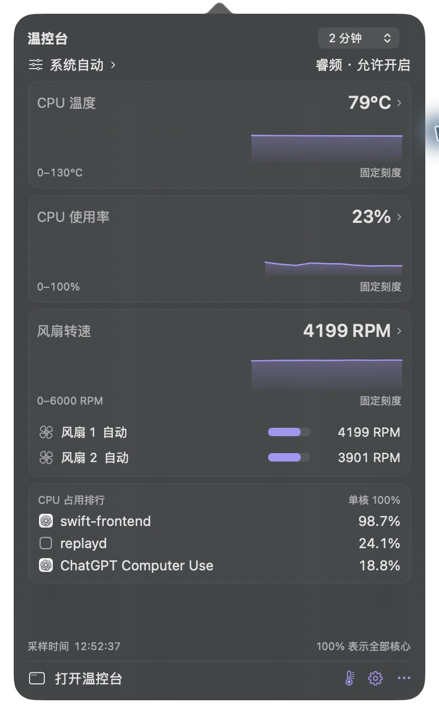
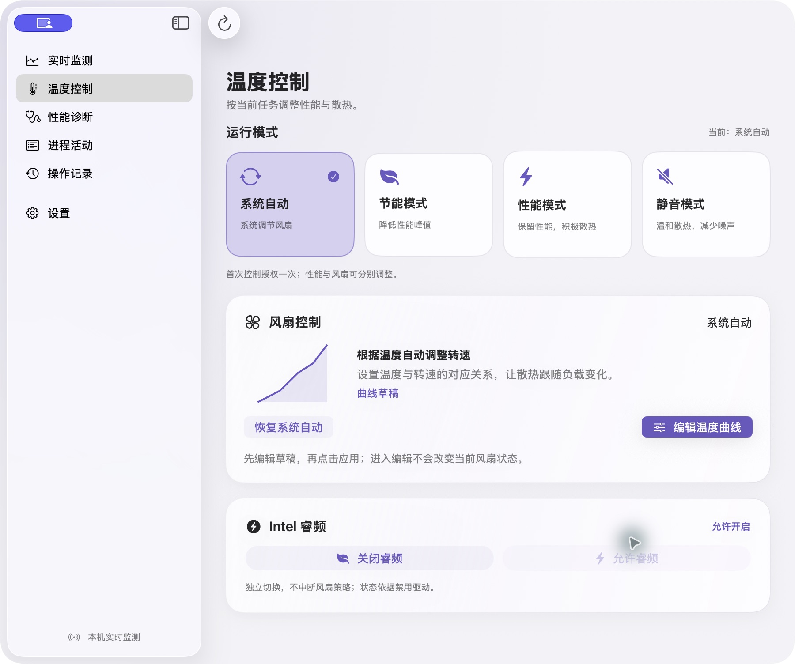
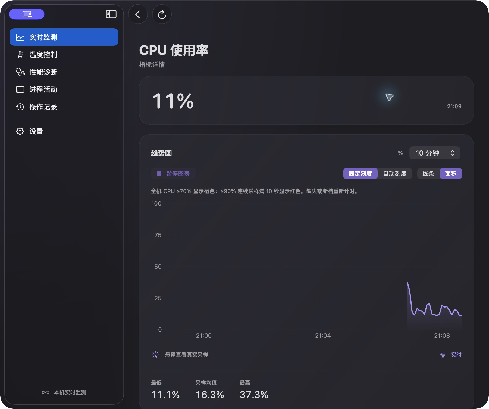

# ThermalScope · 温控台

[简体中文](README.md) | **English**


A native macOS temperature, CPU, fan and performance diagnostics utility, with an Intel build and an experimental Apple Silicon monitoring build. Current application version: **1.16 / build 260**, including the subsequent Dock behavior, icon and stress-test fixes.

## Features

- Menu bar readings and a popover with temperature, CPU usage and fan history.
- A console for live metrics, sensors, CPU/memory/disk process activity and evidence-based diagnostics.
- System automatic, energy saving, performance and quiet modes, plus editable temperature-to-fan-speed curves.
- Independent Intel Turbo Boost control, operation history and sample export.
- System/light/dark appearance, language selection, configurable menu bar and WidgetKit widgets.
- Seeded synthetic stress tests, performance budgets, raw captures and baseline comparisons.

## Screenshots

These are actual application captures saved during development. Readings reflect the capture time. The screenshots use the Chinese interface; select **English** in Settings → Language for the English interface.

### Menu bar graphs

Left-click the menu bar item for temperature, CPU and fan trends, with links into the console.



### Temperature and fan control

Edit the curve draft first, then explicitly apply it. Opening the editor does not change fan control.



### CPU history and metric details

Choose the time range, fixed/automatic scale, line/area display or pause the chart.



The popover and thermal-control captures are from 1.16; the CPU-detail capture is from 1.15, whose layout is retained in 1.16. [Original capture records](docs/screenshots/README.txt).

## Download and first launch

### Prebuilt app — no compilation required

1. Sign in to a GitHub account with access to this private repository and open [Releases](https://github.com/Jackkakaya/ThermalScope/releases).
2. Choose **`ThermalScope-1.16.0-macOS-x86_64.zip`** for Intel or **`ThermalScope-1.16.0-macOS-arm64.zip`** for experimental Apple Silicon monitoring from `v1.16.0`. Extract it and drag `ThermalScope.app` into Applications.
3. Launch the app, then click its item in the top menu bar. The prebuilt app does not require Xcode, Swift or Python.
4. Select English or Simplified Chinese in Settings → Language. Traditional Chinese, Japanese, Korean, German, French and Spanish are also available.

Both packages require **macOS 13 or later**. The Intel build is validated on MacBookPro16,1. **The arm64 archive is an experimental monitoring-only build cross-compiled on Intel, without Apple Silicon runtime validation. Fan, Turbo and power-setting control are disabled; temperature and fan readings may be unavailable.** This development build uses **ad-hoc signing and is not notarized**; macOS may report that the developer cannot be verified. Developer ID signing and notarization remain pending.

The release provides per-architecture install notes, manifests and checksums. Intel uses `INSTALL.txt`, `release-manifest.json` and `SHA256SUMS.txt`; ARM uses `INSTALL-arm64.txt`, `release-manifest-arm64.json` and `SHA256SUMS-arm64.txt`. Download the four assets for your architecture into one directory, then run `shasum -a 256 -c SHA256SUMS.txt` (Intel) or `shasum -a 256 -c SHA256SUMS-arm64.txt` (ARM).

### Build from source

Source builds require macOS 13+, Xcode Command Line Tools with Swift 5.9+, Git and Python 3. Other machines have not completed hardware capability validation. If necessary, install the command line tools and complete the system installer:

```sh
xcode-select --install
```

After authenticating with an account that can access the private repository:

```sh
git clone https://github.com/Jackkakaya/ThermalScope.git
cd ThermalScope
make build
open build/ThermalScope.app
```

`make build` packages the host application, privileged helper and WidgetKit extension, then verifies their signatures. Local builds default to ad-hoc signing.

## How to use

1. **Monitor:** startup begins monitoring in the menu bar without automatically opening the console. Monitoring is read-only by default and does not require an administrator password.
2. **View graphs:** left-click the menu bar item for temperature, CPU usage and fan curves. Right-click for the actions menu.
3. **Open the console:** use “Open ThermalScope” in the popover, or click the Dock icon. Navigate to live monitoring, performance diagnosis or process activity.
4. **Adjust cooling:** choose a mode under Temperature Control, or open the temperature curve editor, review the draft and explicitly apply it. Hardware operations require macOS administrator authorization.
5. **Restore automatic control:** use the system automatic fan action, then check whether the operation is confirmed.
6. **Keep monitoring:** closing the main window hides the Dock icon while the menu bar continues monitoring. Opening the console brings the Dock icon back. Use Quit from the application or menu bar menu to fully exit.
7. **Change language:** choose English, Simplified Chinese or Follow System in Settings → Language; changing the system language is unnecessary.

### Fan and Turbo Boost dependencies

Fan capabilities depend on the machine's AppleSMC interface. Quit other fan controllers, such as Macs Fan Control, before applying fan control to avoid competing controllers.

Turbo Boost control reuses the already installed and macOS-approved `com.rugarciap.DisableTurboBoost` extension, for example from an existing Turbo Boost Switcher installation. This repository does not distribute a new kernel driver or automatically download one. Turbo control may be unavailable without that extension; readable monitoring features remain usable. Quit other Turbo controllers before making Turbo changes to avoid conflicting rules.

CPU utilization, system performance limits and Turbo state are distinct measurements. Missing sensors and history remain missing rather than being represented as zero readings.

## Development workspace

The local development repository is `~/codejk/ThermalScope`; source, tests and `.git` are kept together. Historical delivery artifacts remain outside the repository.

## Development builds

There are no third-party Swift package dependencies. From the repository root:

```sh
make build
```

To choose an output path:

```sh
make build APP="$PWD/build/ThermalScope.app"
# Or invoke the build script directly:
bash scripts/build.sh "$PWD/build/ThermalScope.app"
```

For a fresh release archive, manifest, bilingual install notes and checksums:

```sh
bash scripts/package-release.sh "$PWD/build/releases/v1.16.0"
```

The destination must not already exist. The packaging script verifies the extracted archive as well as the original app bundle. To cross-compile the ARM package:

```sh
THERMALSCOPE_ARCH=arm64 bash scripts/package-release.sh "$PWD/build/releases/v1.16.0-arm64"
```

The host app, helper and widget all target arm64. Cross-architecture runtime checks are skipped and explicitly marked as unexecuted in the manifest. The ARM source is identified by `v1.16.0-arm64` and its independent manifest; the original Intel release tag and assets are preserved.

## Checks and stress tests

```sh
make check
make perf-smoke
```

`make check` runs 75 domain checks, 18 performance-tool checks and the hidden-view update check. `make perf-smoke` executes the complete synthetic workload suite and stores timestamped results under `performance-results/`.

```sh
make perf-standard
make perf-soak
```

Standard runs three seeds per scenario with 120 seconds of process sampling each. Soak runs 30 minutes per scenario. Both generate sustained single-core load. Tests use isolated fixture processes, do not write fan/Turbo/power settings and do not take over a running monitoring instance.

The detailed [performance suite guide](docs/performance/SUITE.txt) and [manual scenario matrix](docs/performance/SCENARIOS.txt) are currently in Chinese. The commands above work regardless of interface language. CPU-side rendering timings are not display FPS. Real UI interactions, sleep/wake, hardware control, whole-machine power and long-term leaks require separate validation.

## Repository layout

| Directory | Responsibility |
|---|---|
| `Sources/CSMC` | AppleSMC, IOKit and native interfaces |
| `Sources/ThermalCore` | Models, history, diagnostic rules, control protocols and recovery |
| `Sources/ThermalScope/Application` | Application entry, window lifecycle and AppModel |
| `Sources/ThermalScope/State` | Readings, history, diagnostics and power optimization state |
| `Sources/ThermalScope/Services` | Control client, process observation and widget publishing |
| `Sources/ThermalScope/MenuBar` | Menu bar rendering, popover and appearance settings |
| `Sources/ThermalScope/Views` | Console, metric details, diagnosis and settings |
| `Sources/ThermalScope/Support` | Theme and localization |
| `Sources/ThermalScope/Diagnostics` | Explicit checks, render benchmarks and synthetic stress |
| `Sources/ThermalScopeHelper` | Privileged hardware control helper |
| `WidgetSupport` / `Widgets` | Shared widget models, views and extension entry |
| `Tests` | Domain and Python performance-tool checks |
| `scripts` / `tools` | Build, packaging, capture and performance reporting tools |
| `docs` | Guides and historical planning, release and validation records |

SwiftPM discovers sources recursively within each target. The directory organization does not change target names or runtime behavior.

## Documentation and Git

Current usage documentation is available in [简体中文](README.md) / [English](README.en.md). [Release installation instructions](docs/INSTALL.txt) and release notes are bilingual. Historical planning and validation logs retain their original language.

- [Development and Git conventions (Chinese)](docs/DEVELOPMENT.txt)
- [Product requirements (Chinese)](docs/PRODUCT_REQUIREMENTS.txt)
- [Validation history](docs/validation/HISTORY.txt)
- [Plans](docs/plans/) / [Release records](docs/releases/)
- [Archived pre-organization usage guide](docs/archive/README-1.16.md)

The main branch is `main`; a separate commit and the `pre-organization` tag preserve the original snapshot. Build caches, app bundles, raw performance output, editor state and local signing credentials are ignored. The GitHub repository is `Jackkakaya/ThermalScope`, initially **Private**.
