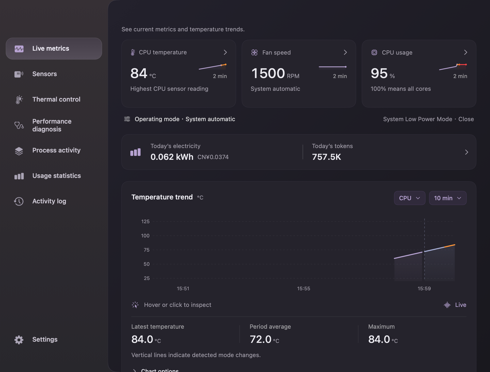
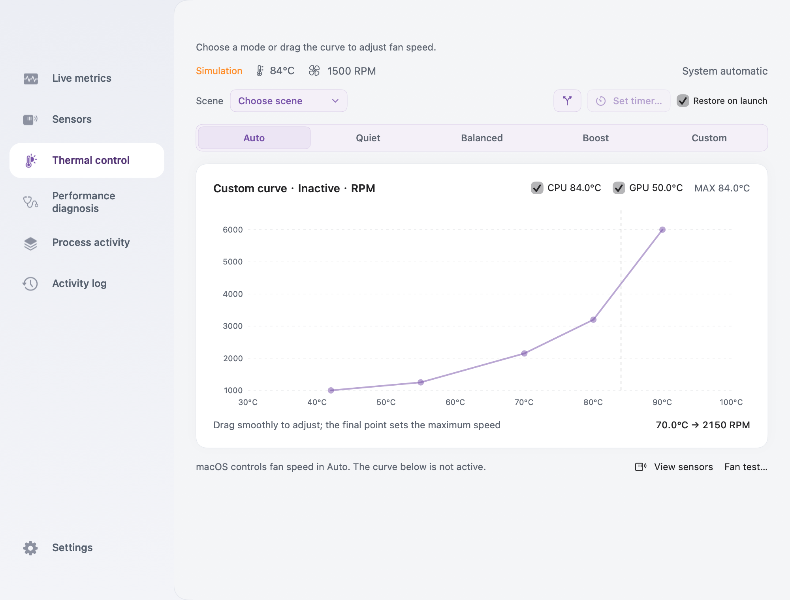
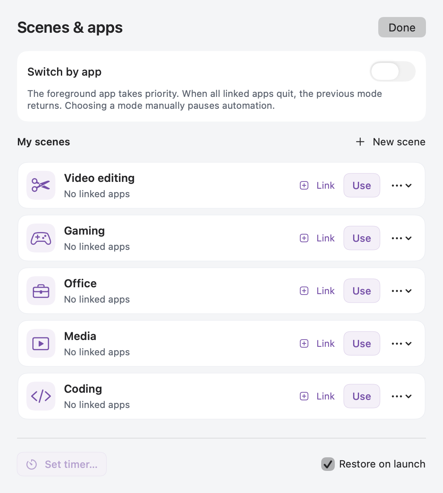
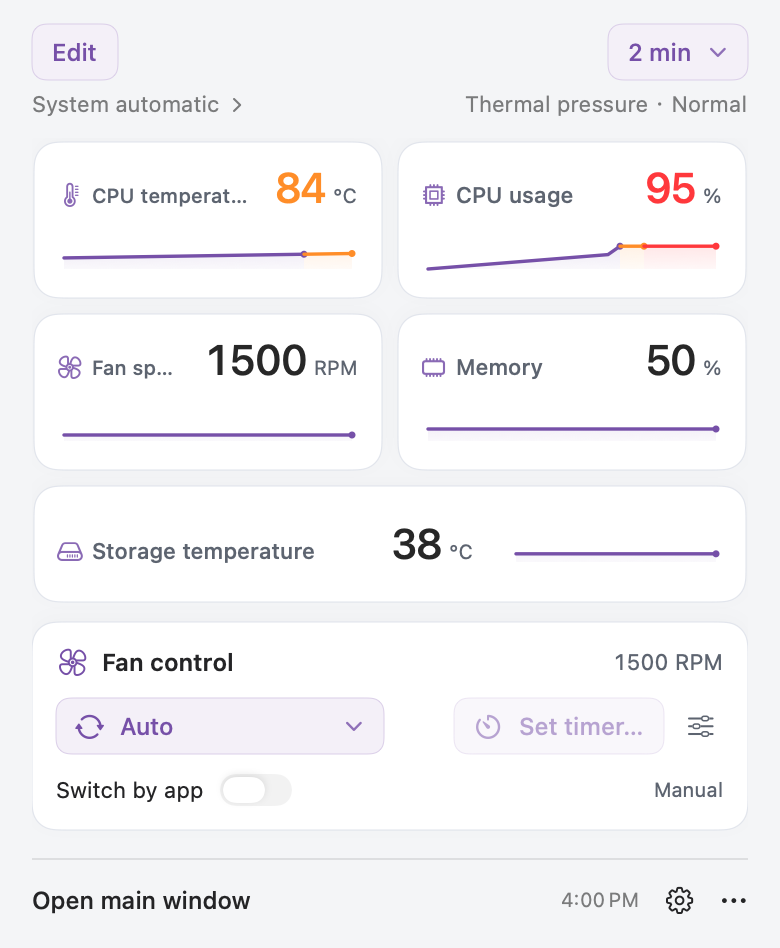
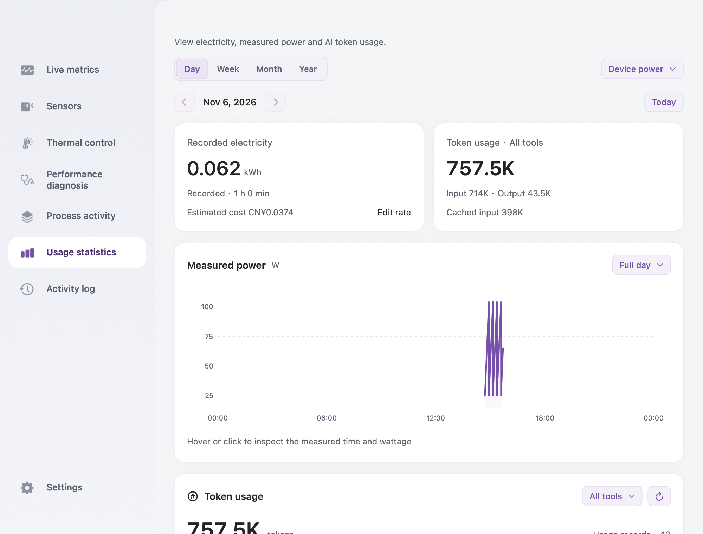
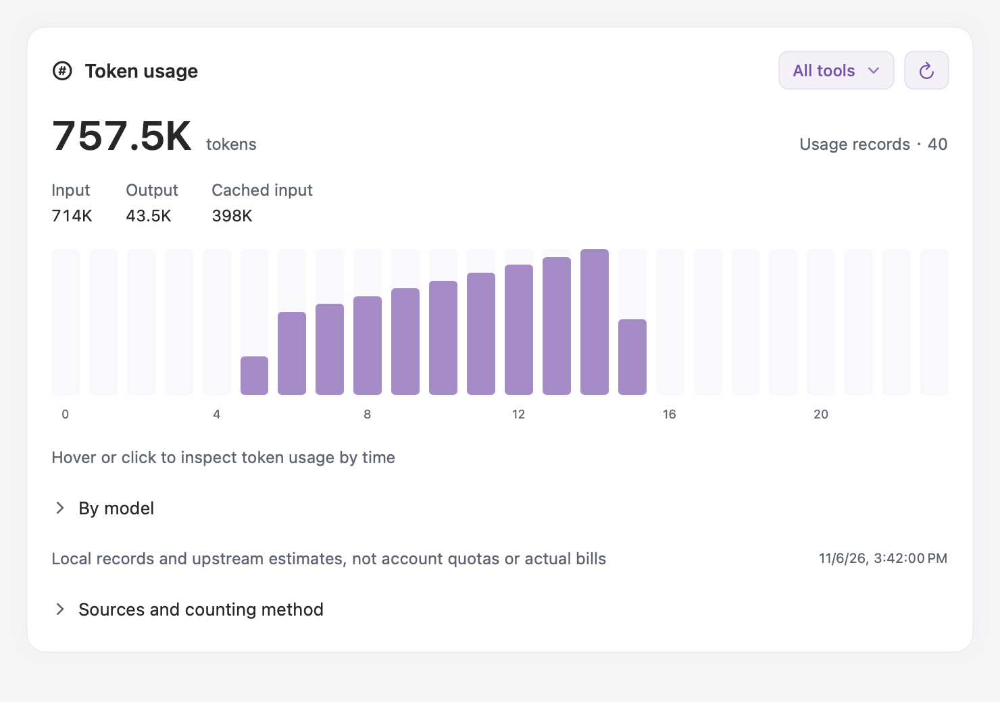

# ShowMac

**English** | [简体中文](README.zh-CN.md)

Free and open source under the [MIT license](LICENSE). All desktop features are included without purchase or activation. If you find ShowMac useful, [give it a Star on GitHub](https://github.com/Jack4A/ShowMac).

Developer: [@Jack4A](https://github.com/Jack4A). The **About ShowMac** card at the bottom of **Settings** shows the app version, developer and GitHub link directly. You can also use **ShowMac → GitHub project**.


A native macOS utility for temperature, fan speed, sensor readings and performance diagnostics. Monitor from the menu bar, inspect recent trends, and choose a fan preset or adjust a temperature–RPM curve.

**Public download: [v1.18.16](https://show-mac.cc/en/#download)** · **macOS 11+** · **Intel & Apple Silicon**

**1.18.16 · build 283** expands local token statistics to 60 agent sources using the bundled MIT-licensed Tokscale core. Electricity and tokens share Usage statistics; Live metrics keeps a compact summary card. See the [release notes](docs/releases/v1.18.16.md).



## Download and launch

1. Open the [ShowMac website](https://show-mac.cc/en/#download) and choose your Mac’s chip. You can also download from [GitHub Releases](https://github.com/Jack4A/ShowMac/releases).
2. Download the ZIP for your Mac, extract it, and move **showmac.app** to **Applications**.
3. Launch the app and click its menu bar item. Monitoring starts in the menu bar; the console does not open automatically.

| Mac | v1.18.16 archive | Control support |
| --- | --- | --- |
| Intel | `showmac-1.18.16-macOS-x86_64.zip` | Fan controls; Turbo Boost depends on an existing approved extension |
| Apple Silicon | `showmac-1.18.16-macOS-arm64.zip` | Experimental, capability-gated fan controls; Turbo Boost and power-setting controls are unavailable |

The prebuilt app needs no Xcode, Swift or Python. Read-only monitoring does not require administrator authorization. Hardware control requests authorization when first needed. Packages are currently ad-hoc signed and not notarized; macOS may report an unverified developer. See the [Intel install guide](docs/INSTALL.txt) and [Apple Silicon guide](docs/INSTALL-arm64.txt).

Both packages target macOS 11. The same app build is checked on macOS 26 and 27; older systems have not all received physical-device validation. Sensor and fan capabilities depend on the Mac. See [Apple Silicon validation scope](docs/APPLE_SILICON_FANS.txt).

## Everyday use

| Task | Where to go |
| --- | --- |
| Quick readings and trends | Left-click the menu bar item. Click a card to open its details. Right-click the menu bar item for actions. |
| Full dashboard | Choose **Open main window** in the popover or click the Dock icon. |
| Inspect history | Open **Live metrics**, click a metric, then choose a time range, scale and line/area style. Hover or click the temperature chart to inspect a sample. Use **Pause chart** to hold the displayed history. |
| Find a sensor | Open **Sensors**. Start with **Overview**, or use **All sensors**, search and the type filter. Click a reading to inspect its trend. |
| Investigate a slowdown | Open **Performance diagnosis** for findings and their evidence; use **Process activity** to inspect CPU, memory and disk activity. |
| Review or export | Open **Activity log** to review recent actions and export samples. |
| Keep monitoring in the background | Close the main window. The Dock icon hides and menu bar monitoring continues. Use **Quit ShowMac** to exit fully. |

When ShowMac is active: **⌘P** opens the menu bar panel, **⌘0** opens the console, and **⌘Q** quits.

Recent history is kept in memory for the current session, up to 30 minutes, and clears when the app quits. Missing readings remain missing. Whole-machine CPU usage uses **100% for all cores**; process rankings use **100% per core** and may exceed 100%.

### Fan presets and curves

Open **Thermal control**, then choose **Auto**, **Quiet**, **Balanced**, **Boost** or **Custom**. Presets apply immediately. Drag a curve point to continuously change temperature and RPM; release it to apply. Drag the final point vertically to set the curve's maximum speed within the fan's rated range. Lowering it caps earlier points too. Arrow keys fine-tune the selected point by 0.1°C or one percentage point of the rated speed range. Select **CPU**, **GPU**, or both checkboxes above the curve; with both selected, the higher temperature drives the same curve. Current temperatures and the effective input are shown alongside them. Thermal protection can override the curve's maximum speed.

Choose **Auto** to return control to macOS at any time. macOS then decides fan speed; the app's curve and temperature thresholds are inactive. App-controlled sessions keep running by default. Click **Set timer…** to return fans to system control after 15/30/60/120 minutes or a custom 1–1440 minutes. Cancel the timer to continue running. A timer applies to this app run only, keeps its original deadline across mode/app switches, and is not restored on relaunch. Quitting, a missing control sensor or a failed control check returns fans to macOS; thermal protection remains active throughout. The page shows continuous control or the remaining time, and flags high temperature with fans near minimum speed without silently taking control. **Fan test…** asks for confirmation before a five-second maximum-speed test.



### Saved fan scenes

Use **Thermal control → Choose scene** to switch between **Video editing**, **Gaming**, **Office**, **Media** and **Coding** templates. Each stores its own curve, CPU/GPU source and maximum-speed point. These scenes change fan control only; they do not change Turbo Boost or system power settings.

Choose **Create or manage scenes…** to open **Scenes & apps**. Use **New scene** to save the displayed curve under a new name; each scene has a menu for renaming or deleting it. Deleting the active scene returns fans to Auto. Select a scene and edit the main curve to update it. The menu bar popover combines presets and saved scenes in one **Fan mode** selector.

**Restore on launch** is enabled by default. After relaunch or wake, ShowMac restores the last successfully confirmed mode; selecting Auto remembers Auto. macOS may ask for authorization again. If a fan controller already owns the fans or required readings are unavailable, ShowMac reports the problem instead of claiming that the scene resumed. Disable the checkbox to stop automatic restoration.

### Switch scenes with your apps



Open **Scenes & apps** from Thermal control or the menu bar fan-control settings. Click the app icon beside a scene to link running apps, or choose another installed app. Each app maps to one scene. Turn on **Switch by app** when ready; it starts off.

A matching foreground app takes priority. Switching to an unrelated app keeps the matched workload scene while that app is running. When all linked apps quit, ShowMac returns to the mode selected before enabling automation. Rules and the enabled state survive relaunch; matching still depends on which apps are running. Choosing a mode or editing a curve manually pauses automation. Re-enable the switch to resume. A timed session ending or rejected control also pauses switching; it does not repeatedly request authorization. Only application identities are read—no window contents or Accessibility permission.

Before applying control, quit other fan controllers to avoid competing commands. On Intel, Turbo Boost control reuses an already installed, macOS-approved `com.rugarciap.DisableTurboBoost` extension. ShowMac does not bundle or download that driver.

### Build your menu bar

1. Open **Settings → Menu bar** and choose a reading from **Choose a Menu Bar Reading**. Available sources include common metrics and readable temperature, fan, power, voltage and current sensors.
2. Click or drag **Icon**, **Value** or **Trend** into the composition. Drag components to reorder them; the same reading can appear more than once.
3. Click a component to edit its display style, icon and color. Choose a built-in symbol or your own image. Colors default to **Black & white (default)**; each component can use a preset or custom color.
4. Expand **Typography and appearance** to adjust menu bar font, item spacing, whole-group outer padding, component inner padding and chart width. Both padding controls support **0**. Warning colors and chart fill can be toggled here.

### Choose the popover cards

Open **Settings → Popover cards → Add card**, or click **Edit** in the menu bar popover. Keep 1–8 metric or sensor cards; use the arrows to reorder and the remove button to delete. Fan controls and top CPU processes can be shown independently. Changes save automatically.

Menu bar components and popover cards are configured separately. The UI preview below shows five example cards and the simplified fan controls. These previews use sample readings; process rankings are hidden.




### Electricity and token usage

Open **Usage statistics** in the sidebar, click the small electricity/token card in **Live metrics**, or use the menu bar’s More menu. The page combines electricity and AI token history under one date range. Switch between **Day / Week / Month / Year**; choose **Full day** or an hour within a day. Hover or click the power curve to see a retained sample’s original time and wattage. Use **Set electricity rate** to enter your own price per kWh and currency. No price is assumed. One kWh is one unit of electricity; estimates use the current flat rate, including when viewing history.

Device power, DC input power and battery discharge are recorded separately where available. Choose a source to inspect it; they are never added together. These are internal readings, not a wall-outlet meter or a utility bill. Coverage is shown explicitly. Recording starts with this version while ShowMac runs, including when its window is hidden. Sleep, app exit and unreadable intervals are excluded. Local history is saved periodically and on normal sleep/quit, and survives relaunch. Power detail retains the original first, minimum, maximum and last sample per minute for seven days, then per hour; each point keeps its measured timestamp and wattage. Sampling gaps stay disconnected. Old energy-only history cannot reconstruct past power readings.



The **Token usage** chart supports the full **60-source Tokscale catalog**, including Codex, Claude Code, Cursor, Gemini, OpenCode, Cline, Roo Code, Kiro, Zed and GitHub Copilot. View time buckets, filter tools, search detected sources and expand **By model**. Cache and reasoning categories are included in input/output once. Some upstream sources estimate tokens when exact counters are absent. These totals are not account quota or actual bills.

The native engine reads local logs/databases/exports in offline mode, checks changes every minute and reuses cached metadata. Cursor requires a previously synced local Tokscale cache; ShowMac does not log in or sync accounts. Missing logs, web chats and other devices are outside coverage. Source settings allow pausing scans and adding folders where supported. No transcript text or credentials are cached or uploaded. [All sources and implementation](docs/TOKEN_USAGE.md).



### Appearance, language and widgets

In **Settings**, choose **Follow system**, **Light** or **Dark** under **Theme**. **Interface language** offers English, Simplified/Traditional Chinese, Japanese, Korean, German, French and Spanish. The app defaults to following the system language; some other locales use explicit English fallbacks.

Selection menus and segmented controls share a purple palette in both appearances, including fan presets, chart options, font, icon and color choices, and the popover time range. Use arrow keys and Return in an open selection menu; Escape cancels without closing the main popover. Custom colors and image selection still use the system panels.

Set **Sampling interval** or use **Refresh readings** in the same page. Expand **System widgets** for widget options. Widgets support Notification Center on macOS 11+ and the desktop on macOS 14+.

## Check for updates

Open **Settings → About ShowMac → Check for updates**, or **ShowMac → Check for Updates…**. Background checks run at most once a day and can be disabled in Settings. When a stable update is available, choose the official website or GitHub, download the archive for your Mac, quit ShowMac and replace the app in Applications. Update checks request only public release metadata; hardware readings stay on your Mac.

## More screenshots

Captured from the installed **v1.18.1 / build 267** app on macOS 27, using its English interface and actual readings. Values, available sensors and process names reflect the capture session. [Capture records](docs/screenshots/v1.18.1/README.md).

<details>
<summary>Light appearance</summary>


</details>

<details>
<summary>Readable sensors and recent trends</summary>


</details>

<details>
<summary>CPU history and chart controls</summary>


</details>

## Build and check

Source builds require Git, Python 3 and full **Xcode 26.5/26.6 with the macOS 26.5 SDK**. Xcode 27 raises the deployment floor to macOS 12 and is not used for the macOS 11 release build. There are no third-party Swift package dependencies. Adjust `DEVELOPER_DIR` below to your Xcode installation.

```sh
export DEVELOPER_DIR=/Applications/Xcode_26.6.app/Contents/Developer
git clone https://github.com/Jack4A/ShowMac.git
cd ShowMac
make build
open build/showmac.app
```

`make build` packages the app, privileged helper and WidgetKit extension and verifies signatures. To choose a destination, use `make build APP="$PWD/build/showmac.app"`.

```sh
make check
make perf-smoke
```

Checks cover core policies, release verification, performance tools, localization, menu/card rendering and compatibility layouts. The synthetic stress suite uses isolated processes and does not write fan, Turbo or power settings. See the [performance guide](docs/performance/SUITE.txt) for standard/soak profiles, budgets and validation limits.

Pushes to `main`, pull requests and manual workflow runs produce Intel/ARM64 build artifacts. A matching version tag publishes verified release assets after package and cross-version appearance checks pass. Packaging commands, checksums, signing status and the workflow are documented in [CI and releases](docs/CI-RELEASE.md).

## Project documentation

- [中文使用说明](README.zh-CN.md)
- [Development and Git conventions](docs/DEVELOPMENT.txt)
- [Hardware validation scope](docs/APPLE_SILICON_FANS.txt)
- [Product requirements](docs/PRODUCT_REQUIREMENTS.txt)
- [Performance scenarios](docs/performance/SCENARIOS.txt) · [Validation history](docs/validation/HISTORY.txt)
- [Release notes](docs/releases/) · [Historical plans](docs/plans/)
- [Archived 1.16 guide](docs/archive/README-1.16.md)
