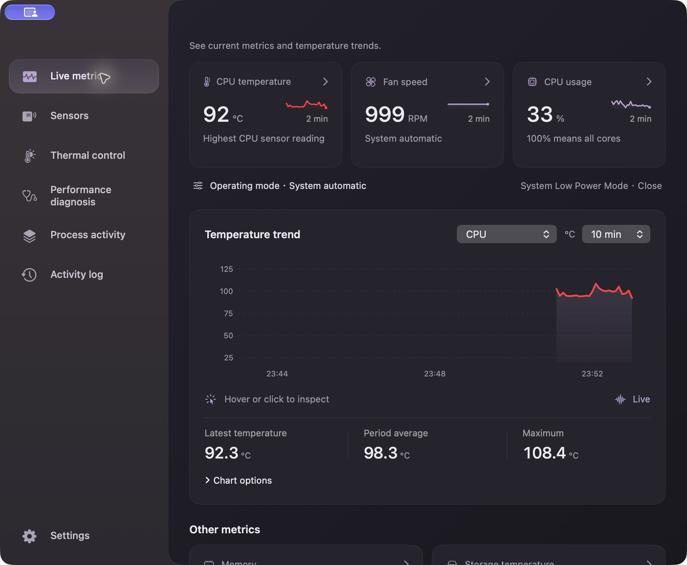
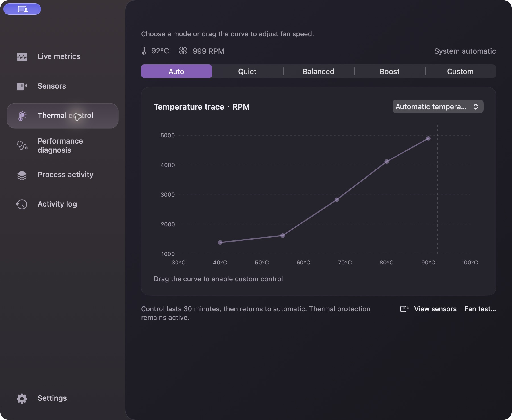
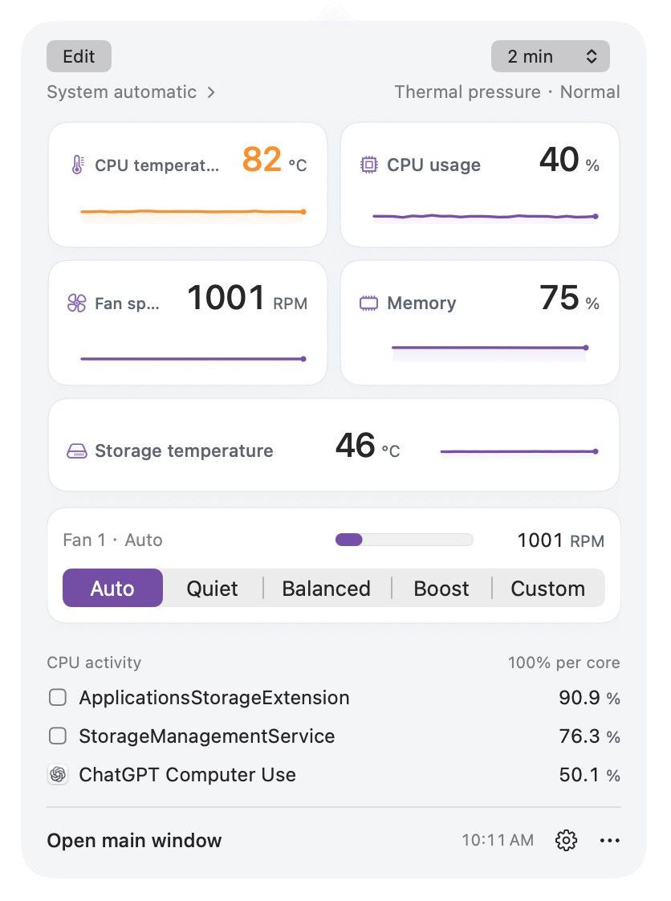
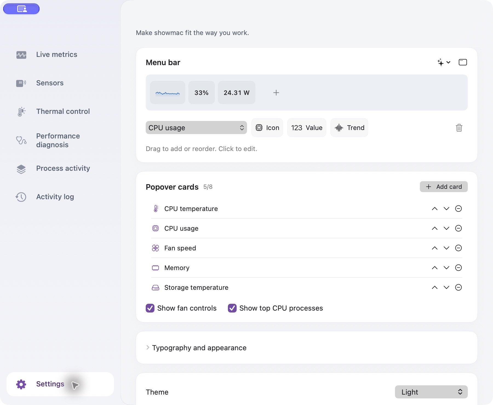
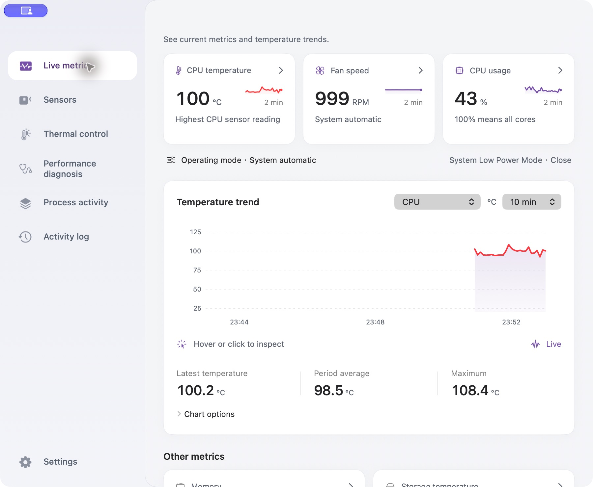
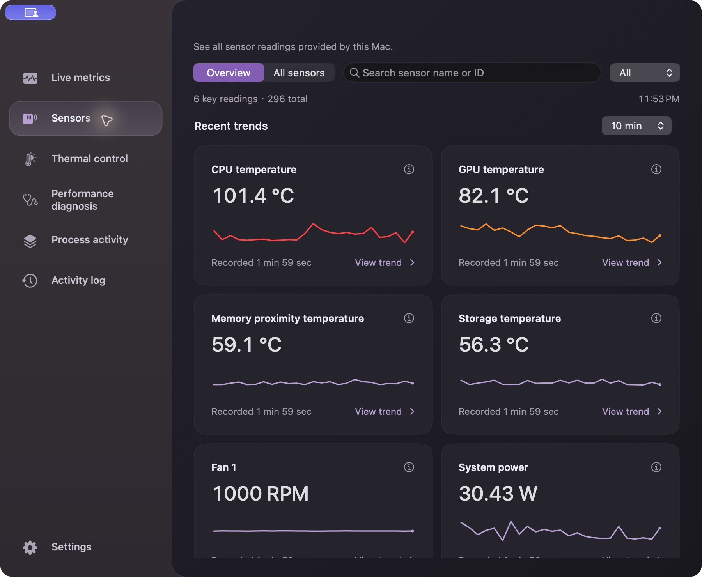
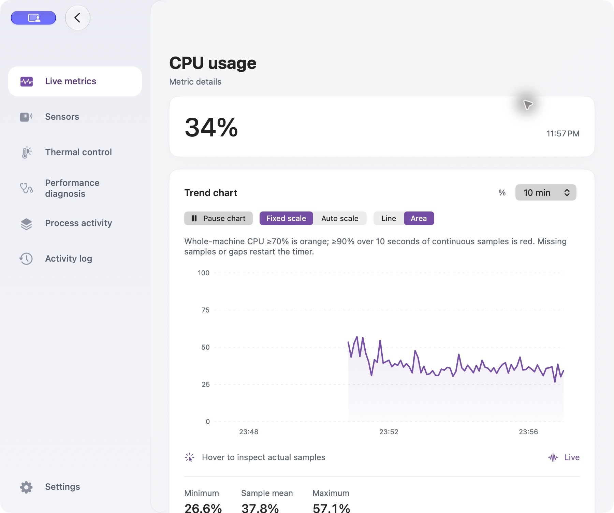

# ShowMac

**English** | [简体中文](README.zh-CN.md)

Free and open source under the [MIT license](LICENSE). All desktop features are included without purchase or activation. If you find ShowMac useful, [give it a Star on GitHub](https://github.com/Jackkakaya/ThermalScope).


A native macOS utility for temperature, fan speed, sensor readings and performance diagnostics. Monitor from the menu bar, inspect recent trends, and choose a fan preset or adjust a temperature–RPM curve.

**Current release: [v1.18.2 · build 269](https://show-mac.cc/en/#download)** · **macOS 11+** · **Intel & Apple Silicon**



## Download and launch

1. Open the [ShowMac website](https://show-mac.cc/en/#download) and choose your Mac’s chip. You can also download from [GitHub Releases](https://github.com/Jackkakaya/ThermalScope/releases).
2. Download the ZIP for your Mac, extract it, and move **showmac.app** to **Applications**.
3. Launch the app and click its menu bar item. Monitoring starts in the menu bar; the console does not open automatically.

| Mac | v1.18.2 archive | Control support |
| --- | --- | --- |
| Intel | `showmac-1.18.2-macOS-x86_64.zip` | Fan controls; Turbo Boost depends on an existing approved extension |
| Apple Silicon | `showmac-1.18.2-macOS-arm64.zip` | Experimental, capability-gated fan controls; Turbo Boost and power-setting controls are unavailable |

The prebuilt app needs no Xcode, Swift or Python. Read-only monitoring does not require administrator authorization. Hardware control requests authorization when first needed. Packages are currently ad-hoc signed and not notarized; macOS may report an unverified developer. See the [Intel install guide](docs/INSTALL.txt) and [Apple Silicon guide](docs/INSTALL-arm64.txt).

Both packages target macOS 11. The same app build is checked on macOS 26 and 27; older systems have not all received physical-device validation. Sensor and fan capabilities depend on the Mac. See [Apple Silicon validation scope](docs/APPLE_SILICON_FANS.txt).

## Everyday use

| Task | Where to go |
| --- | --- |
| Quick readings and trends | Left-click the menu bar item. Click a card to open its details. Right-click the menu bar item for actions. |
| Full dashboard | Choose **Open main window** in the popover or click the Dock icon. |
| Inspect history | Open **Live metrics**, click a metric, then choose a time range, scale and line/area style. Hover or click the temperature chart to inspect a sample. Use **Pause chart** to hold the displayed history. |
| Find a sensor | Open **Sensors**. Start with **Overview**, or use **All sensors**, search and the type filter. Click a reading to inspect its trend. |
| Investigate a slowdown | Open **Performance diagnosis** for findings and their evidence; use **Process activity** to inspect CPU, memory and disk activity. |
| Review or export | Open **Activity log** to review recent actions and export samples. |
| Keep monitoring in the background | Close the main window. The Dock icon hides and menu bar monitoring continues. Use **Quit ShowMac** to exit fully. |

When ShowMac is active: **⌘P** opens the menu bar panel, **⌘0** opens the console, and **⌘Q** quits.

Recent history is kept in memory for the current session, up to 30 minutes, and clears when the app quits. Missing readings remain missing. Whole-machine CPU usage uses **100% for all cores**; process rankings use **100% per core** and may exceed 100%.

### Fan presets and curves

Open **Thermal control**, then choose **Auto**, **Quiet**, **Balanced**, **Boost** or **Custom**. Presets apply immediately. Drag a curve point to change temperature and RPM; release it to apply. Arrow keys fine-tune the selected point. The temperature-source selector chooses which reading drives the curve.

Choose **Auto** to return control to macOS at any time. macOS then decides fan speed; the app's curve and temperature thresholds are inactive. App-controlled sessions apply thermal protection and last up to 30 minutes before returning control to macOS. The page shows control state and remaining time, and flags high temperature with fans near minimum speed without silently taking control. **Fan test…** asks for confirmation before a five-second maximum-speed test.



Before applying control, quit other fan controllers to avoid competing commands. On Intel, Turbo Boost control reuses an already installed, macOS-approved `com.rugarciap.DisableTurboBoost` extension. ShowMac does not bundle or download that driver.

### Build your menu bar

1. Open **Settings → Menu bar** and choose a reading from **Choose a Menu Bar Reading**. Available sources include common metrics and readable temperature, fan, power, voltage and current sensors.
2. Click or drag **Icon**, **Value** or **Trend** into the composition. Drag components to reorder them; the same reading can appear more than once.
3. Click a component to edit its display style, icon and color. Choose a built-in symbol or your own image. Colors default to **Black & white (default)**; each component can use a preset or custom color.
4. Expand **Typography and appearance** to adjust menu bar font, item spacing, whole-group outer padding, component inner padding and chart width. Both padding controls support **0**. Warning colors and chart fill can be toggled here.

### Choose the popover cards

Open **Settings → Popover cards → Add card**, or click **Edit** in the menu bar popover. Keep 1–8 metric or sensor cards; use the arrows to reorder and the remove button to delete. Fan controls and top CPU processes can be shown independently. Changes save automatically.

Menu bar components and popover cards are configured separately. The screenshot below shows a five-card example with both optional sections enabled.





### Appearance, language and widgets

In **Settings**, choose **Follow system**, **Light** or **Dark** under **Theme**. **Interface language** offers English, Simplified/Traditional Chinese, Japanese, Korean, German, French and Spanish. The app defaults to following the system language; some other locales use explicit English fallbacks.

Set **Sampling interval** or use **Refresh readings** in the same page. Expand **System widgets** for widget options. Widgets support Notification Center on macOS 11+ and the desktop on macOS 14+.

## More screenshots

Captured from the installed **v1.18.1 / build 267** app on macOS 27, using its English interface and actual readings. Values, available sensors and process names reflect the capture session. [Capture records](docs/screenshots/v1.18.1/README.md).

<details>
<summary>Light appearance</summary>



</details>

<details>
<summary>Readable sensors and recent trends</summary>



</details>

<details>
<summary>CPU history and chart controls</summary>



</details>

## Build and check

Source builds require Git, Python 3 and full **Xcode 26.5/26.6 with the macOS 26.5 SDK**. Xcode 27 raises the deployment floor to macOS 12 and is not used for the macOS 11 release build. There are no third-party Swift package dependencies. Adjust `DEVELOPER_DIR` below to your Xcode installation.

```sh
export DEVELOPER_DIR=/Applications/Xcode_26.6.app/Contents/Developer
git clone https://github.com/Jackkakaya/ThermalScope.git
cd ThermalScope
make build
open build/showmac.app
```

`make build` packages the app, privileged helper and WidgetKit extension and verifies signatures. To choose a destination, use `make build APP="$PWD/build/showmac.app"`.

```sh
make check
make perf-smoke
```

Checks cover core policies, release verification, performance tools, localization, menu/card rendering and compatibility layouts. The synthetic stress suite uses isolated processes and does not write fan, Turbo or power settings. See the [performance guide](docs/performance/SUITE.txt) for standard/soak profiles, budgets and validation limits.

Pushes to `main`, pull requests and manual workflow runs produce Intel/ARM64 build artifacts. A matching version tag publishes verified release assets after package and cross-version appearance checks pass. Packaging commands, checksums, signing status and the workflow are documented in [CI and releases](docs/CI-RELEASE.md).

## Project documentation

- [中文使用说明](README.zh-CN.md)
- [Development and Git conventions](docs/DEVELOPMENT.txt)
- [Hardware validation scope](docs/APPLE_SILICON_FANS.txt)
- [Product requirements](docs/PRODUCT_REQUIREMENTS.txt)
- [Performance scenarios](docs/performance/SCENARIOS.txt) · [Validation history](docs/validation/HISTORY.txt)
- [Release notes](docs/releases/) · [Historical plans](docs/plans/)
- [Archived 1.16 guide](docs/archive/README-1.16.md)
