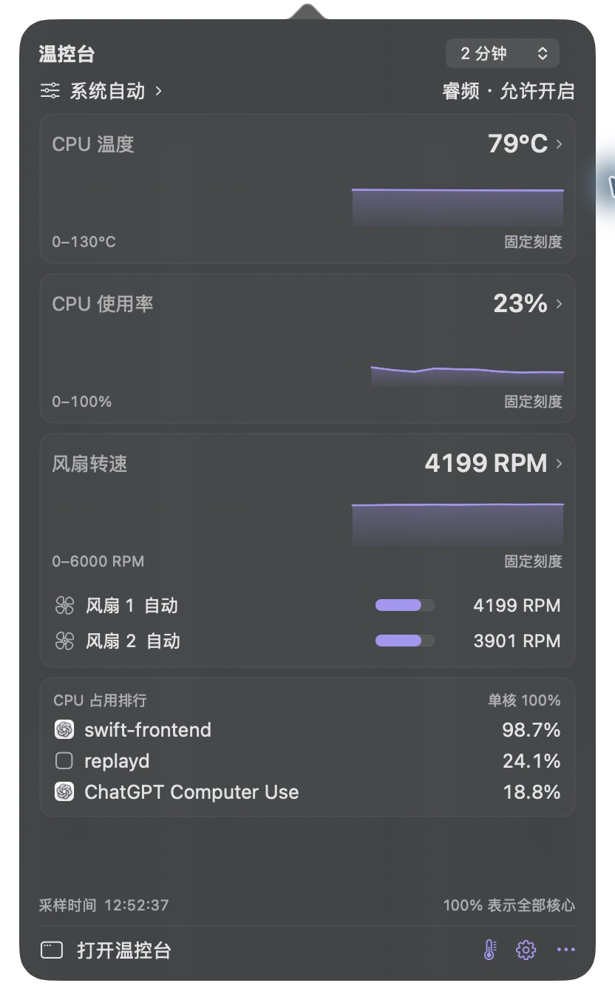
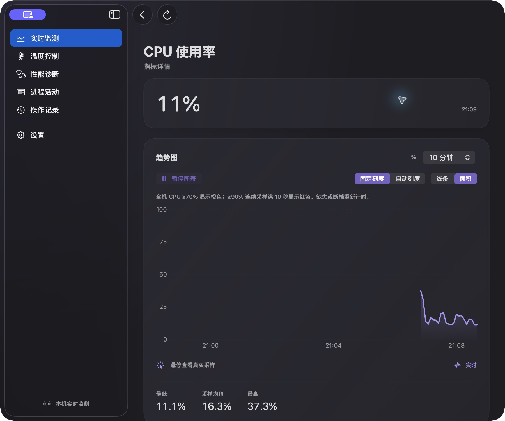

# 温控台 · ThermalScope

**简体中文** | [English](README.en.md)


Intel Mac 的温度、CPU、风扇和性能诊断工具。当前应用版本为 **1.16 / build 260**，包含后续 Dock 交互、图标和压测修复。

## 功能

- 状态栏显示温度、CPU 使用率和风扇转速，左键打开多组趋势曲线。
- 控制台查看实时指标、传感器、CPU/内存/磁盘进程活动和性能诊断依据。
- 系统自动、节能、性能、静音模式，以及可编辑的温度—风扇转速曲线。
- 独立 Intel 睿频控制、操作记录和采样导出。
- 系统/浅色/深色主题、多语言、状态栏自定义和 WidgetKit 小组件。
- 固定随机种子的模拟压测、性能预算、原始采样和基线回归比较。

## 截图

以下为开发过程中保存的实机截图，数值代表拍摄时的状态。

### 状态栏曲线面板

左键点击状态栏即可查看温度、CPU 和风扇趋势，并进入控制台。



### 温度与风扇控制

先编辑曲线草稿，再显式应用；进入编辑页不会改变当前风扇状态。


### CPU 历史与指标详情

支持时间范围、固定/自动刻度、线条/面积以及暂停图表。



截图版本与来源见 [截图记录](docs/screenshots/README.txt)。

## 安装与首次启动

### 下载应用包（无需编译）

1. 登录有此私有仓库访问权限的 GitHub 账号，打开 [Releases](https://github.com/Jackkakaya/ThermalScope/releases)。
2. 下载 `v1.16.0` 的 **`ThermalScope-1.16.0-macOS-x86_64.zip`**，解压后将 `ThermalScope.app` 拖到“应用程序”。
3. 打开应用，点击顶部状态栏图标开始使用。预编译应用不需要安装 Xcode、Swift 或 Python。
4. 在“设置 → 语言”切换简体中文或 English。应用还支持繁体中文、日语、韩语、德语、法语和西班牙语。

应用包面向 **Intel Mac（x86_64），最低 macOS 13**。当前实测机型为 Intel MacBookPro16,1；Apple Silicon 原生版尚未提供。当前为本地 **ad-hoc 签名、未经公证**的开发构建，macOS 可能提示无法验证开发者。Developer ID 签名与公证仍待完成。

Release 同时提供双语 `INSTALL.txt`、`release-manifest.json` 和 `SHA256SUMS.txt`。将四个附件下载到同一目录后，可运行 `shasum -a 256 -c SHA256SUMS.txt` 验证文件完整性。

### 从源码构建

源码构建需要 macOS 13+、支持 Swift 5.9+ 的 Xcode Command Line Tools、Git 和 Python 3。其他机型尚未完成能力验证。

如果尚未安装命令行工具，先运行并完成系统安装提示：

```sh
xcode-select --install
```

访问此私有仓库需要 GitHub 账号已有权限。完成认证后：

```sh
git clone https://github.com/Jackkakaya/ThermalScope.git
cd ThermalScope
make build
open build/ThermalScope.app
```

`make build` 会生成主程序、辅助程序和 WidgetKit 扩展，并进行签名校验；当前使用本地 ad-hoc 签名。正式分发所需的 Developer ID 签名、公证与权限配置仍待完成。

## 使用方式

1. **打开监测**：启动后先在状态栏监测，不自动弹出控制台。监测默认只读，不需要管理员密码。
2. **查看曲线**：左键点击状态栏图标，打开温度、CPU 使用率和风扇转速面板；右键打开操作菜单。
3. **打开控制台**：点击面板的“打开温控台”，或点击 Dock 图标。选择“实时监测”“性能诊断”“进程活动”等页面查看详情。
4. **调整散热**：在“温度控制”选择模式，或打开“编辑温度曲线”，检查草稿后显式应用。硬件操作需要系统管理员授权。
5. **恢复自动**：使用“恢复系统自动”将风扇控制交回系统，并查看操作结果是否确认。
6. **后台运行**：关闭主窗口后隐藏 Dock 图标，状态栏继续监测；再次打开控制台时恢复 Dock 图标。彻底退出请使用应用菜单或状态栏的“退出温控台”。
7. **语言切换**：在“设置 → 语言”选择简体中文、English 或跟随系统；不需要修改系统语言。

### 温控与睿频依赖

风扇能力取决于本机 AppleSMC 接口。实际控制前先退出 Macs Fan Control 等其他风扇控制软件，避免同时控制。

睿频控制复用本机已安装且获系统批准的 `com.rugarciap.DisableTurboBoost` 扩展（例如已有 Turbo Boost Switcher 安装）。工程不附带新内核驱动，也不会自动下载驱动或绕过系统安全设置。没有该扩展时，睿频控制可能不可用，仍可使用可读的监测功能。使用睿频控制前先退出其他睿频控制器，避免规则互相覆盖。

CPU 使用率、系统性能限制和睿频状态是不同指标；传感器与历史缺失保持缺失，不补造零读数。

## 工程位置

开发仓库位于 `~/codejk/ThermalScope`。源码、测试和 `.git` 均在此目录，历史构建交付物保留在原聊天输出目录。

## 开发构建

没有第三方 Swift 包依赖。在仓库目录中运行：

```sh
make build
```

也可指定输出位置：

```sh
make build APP="$PWD/build/ThermalScope.app"
# 或直接调用构建脚本
bash scripts/build.sh "$PWD/build/ThermalScope.app"
```

需要生成新的应用 ZIP、清单、双语安装说明与校验值时：

```sh
bash scripts/package-release.sh "$PWD/build/releases/v1.16.0"
```

目标目录必须不存在；脚本要求 Git 工作区干净，并验证 ZIP 解压后的签名与执行权限。

## 检查与压测

```sh
make check
make perf-smoke
```

`make check` 运行 75 项领域检查、18 项性能工具检查，以及隐藏视图更新检查。`make perf-smoke` 运行完整模拟负载套件，结果保存在带时间标记的 `performance-results/` 子目录。

```sh
make perf-standard
make perf-soak
```

standard 为每场景三个种子、每轮 120 秒采样；soak 为每场景 30 分钟。两者都会持续制造单核负载。测试使用独立模拟进程，不写风扇、睿频或电源设置，也不接管正在运行的监控应用。

精确指定结果目录、场景与基线的方法见 [压测使用说明](docs/performance/SUITE.txt)。CPU 侧绘图耗时不等于屏幕帧率；真实 UI 交互、睡眠恢复、硬件控制、整机功耗和长期泄漏仍需专项验证。

## 代码结构

| 目录 | 职责 |
|---|---|
| `Sources/CSMC` | AppleSMC、IOKit 与底层原生接口 |
| `Sources/ThermalCore` | 采样模型、历史、诊断规则、控制协议与故障恢复 |
| `Sources/ThermalScope/Application` | 应用入口、窗口生命周期和 AppModel |
| `Sources/ThermalScope/State` | 实时读数、历史、诊断和电源优化状态 |
| `Sources/ThermalScope/Services` | 控制客户端、进程观察和小组件发布 |
| `Sources/ThermalScope/MenuBar` | 状态栏绘制、快捷面板与外观设置 |
| `Sources/ThermalScope/Views` | 控制台、指标详情、诊断和设置界面 |
| `Sources/ThermalScope/Support` | 主题和本地化 |
| `Sources/ThermalScope/Diagnostics` | 独立检查、渲染基准与模拟压测 |
| `Sources/ThermalScopeHelper` | 需要授权的硬件控制辅助程序 |
| `WidgetSupport` / `Widgets` | 小组件共享模型、界面与扩展入口 |
| `Tests` | 领域检查和 Python 性能工具测试 |
| `scripts` / `tools` | 构建、图标打包、采样和性能报告工具 |
| `docs` | 当前说明、历史计划、发布与验证记录 |

SwiftPM 递归发现各 target 内的源码，目录整理不改变 target 名称或运行逻辑。

## 文档与版本管理

当前使用说明提供 [简体中文](README.md) / [English](README.en.md)，[发布安装指南](docs/INSTALL.txt) 与 Release 说明为双语；历史计划和验证日志保留原文。

- [开发与 Git 约定](docs/DEVELOPMENT.txt)
- [性能场景与人工验收](docs/performance/SCENARIOS.txt)
- [产品要求](docs/PRODUCT_REQUIREMENTS.txt)
- [验证历史](docs/validation/HISTORY.txt)
- [历次计划](docs/plans/) / [发布记录](docs/releases/)
- [整理前的完整使用说明（历史资料）](docs/archive/README-1.16.md)

本地 Git 仓库使用 `main` 分支，整理前的原始快照已单独提交。编译缓存、应用包、性能原始输出、编辑器状态和本地签名材料不纳入版本管理。GitHub 远程仓库为 `Jackkakaya/ThermalScope`，初始可见性为 **Private**。
