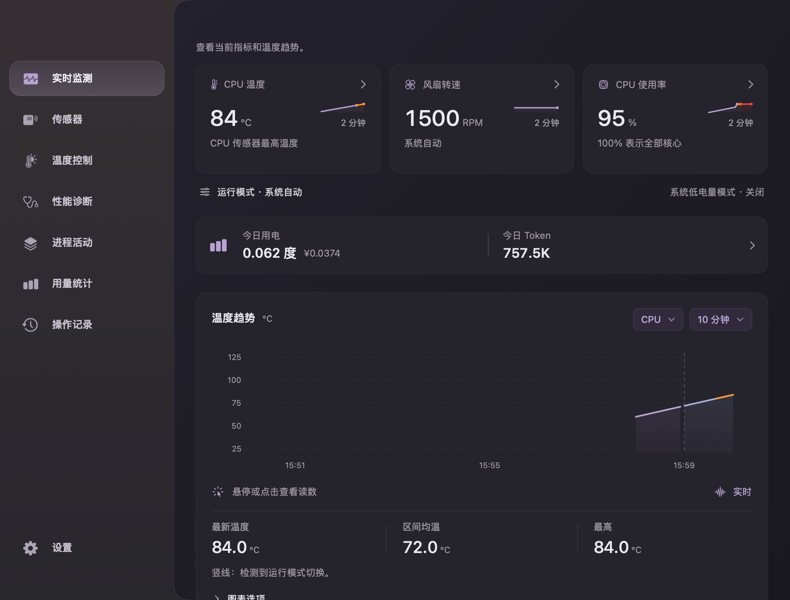
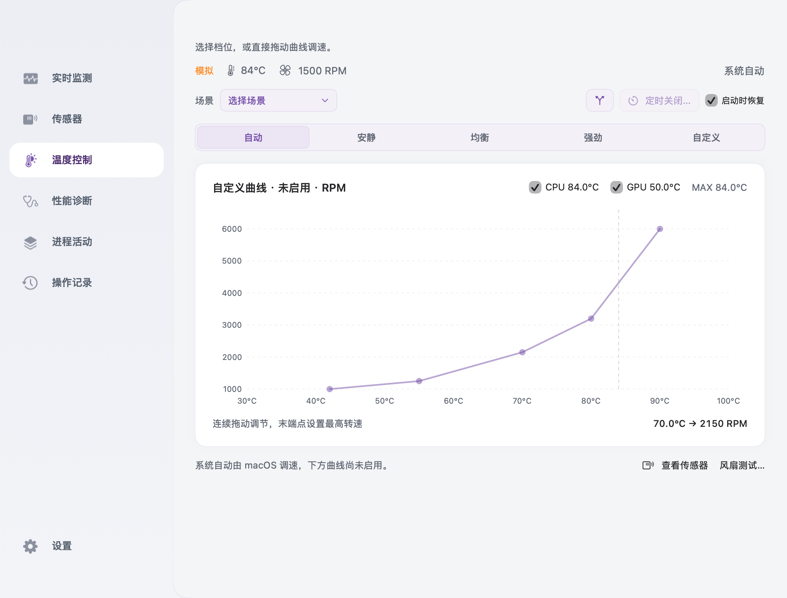
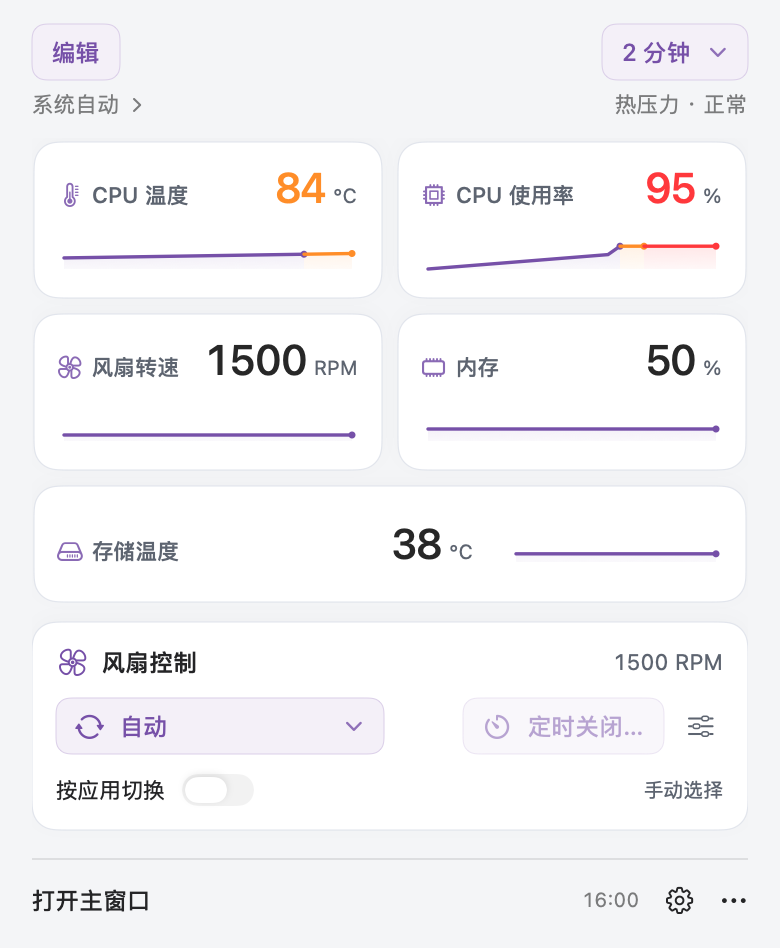
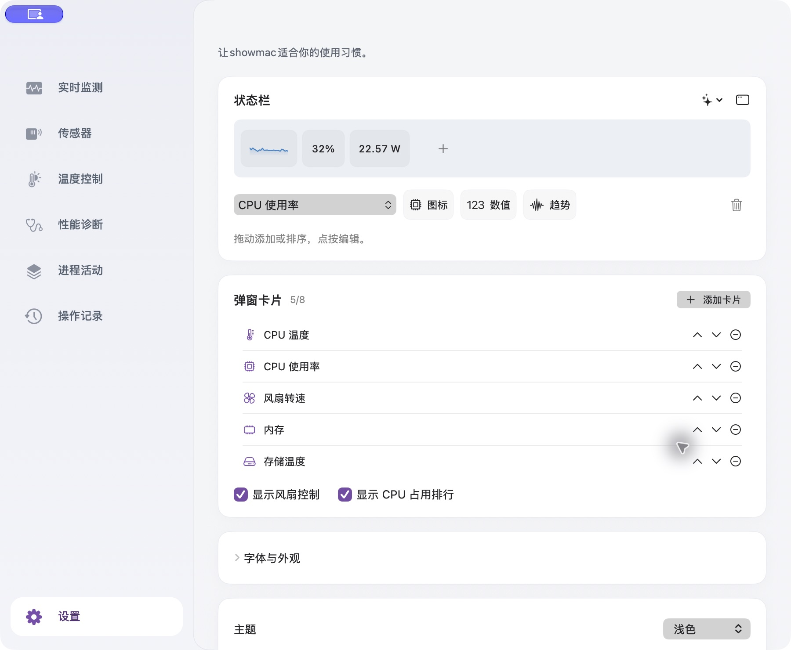
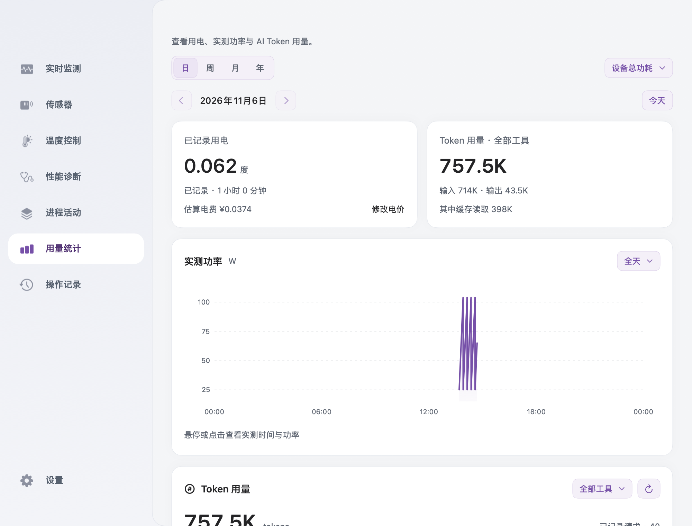
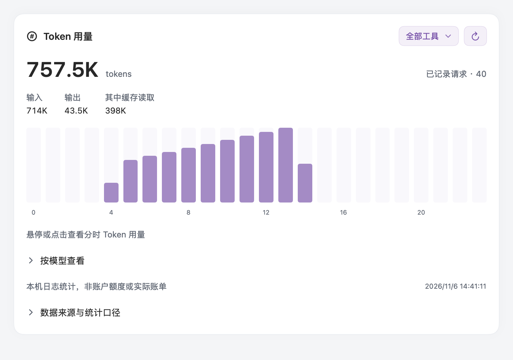
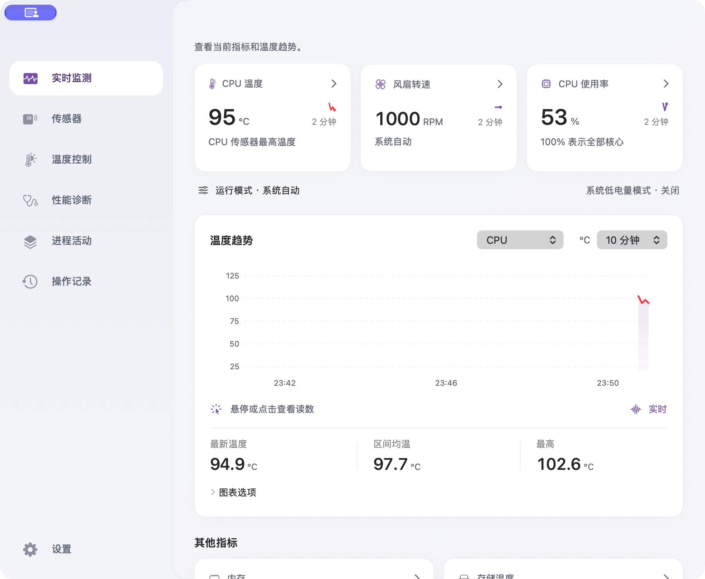
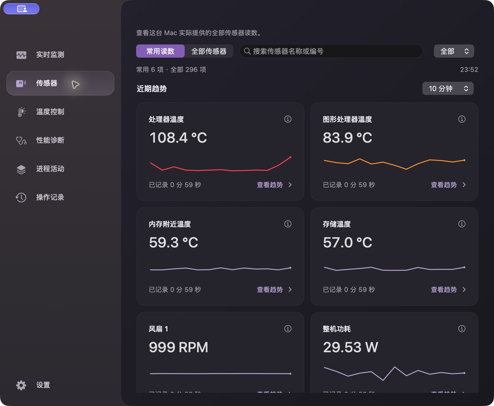
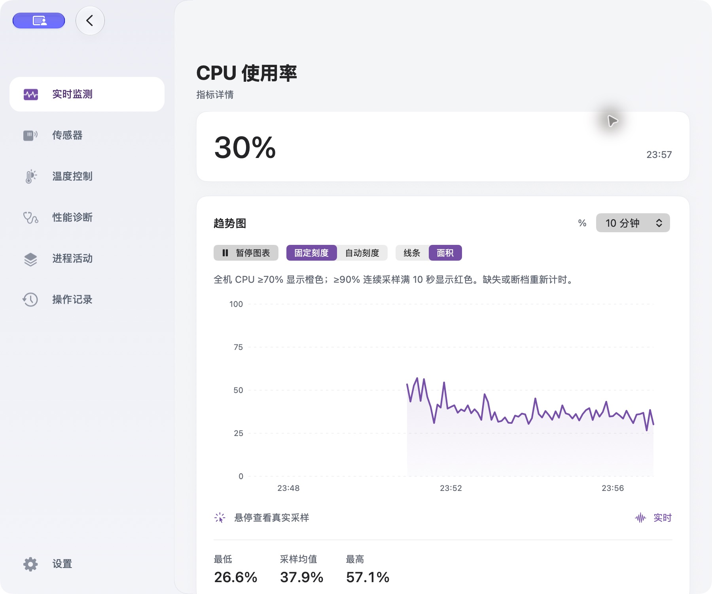

# ShowMac

[English](README.md) | **简体中文**

基于 [MIT 许可证](LICENSE) 免费开源，完整版功能无需购买或激活。如果对你有帮助，欢迎[在 GitHub 点个 Star](https://github.com/Jack4A/ShowMac)。

开发者：[@Jack4A](https://github.com/Jack4A)。**设置底部的“关于 ShowMac”卡片**直接展示软件版本、开发者与 GitHub 入口，也可以使用 **ShowMac → GitHub 项目**。


原生 macOS 温度、风扇与性能诊断工具。在菜单栏查看读数，进入主窗口观察近期趋势，或直接选择风扇档位、调整温度—转速曲线。

**公开下载：[v1.18.13](https://show-mac.cc/zh/#download)** · **macOS 11+** · **Intel 与 Apple Silicon**

**1.18.13 · build 280** 新增独立的「用量统计」页面，同页查看用电与本机 AI Token；首页保留紧凑的小卡片。支持 Codex、Claude Code 的日、周、月、年统计、分时趋势和模型明细，后台增量扫描。详见[更新说明](docs/releases/v1.18.13.md)。



本文截图使用中文界面，具体拍摄版本见图片说明；应用内可在“设置 → 界面语言”切换语言。仓库默认首页使用英文。

## 下载与启动

1. 打开 [ShowMac 官网](https://show-mac.cc/zh/#download)，按本机芯片下载。也可使用 [GitHub Releases](https://github.com/Jack4A/ShowMac/releases)。
2. 下载适合本机芯片的 ZIP，解压后将 **showmac.app** 拖到“应用程序”。
3. 打开应用，点击顶部菜单栏项目。启动后先在菜单栏监测，不自动弹出主窗口。

| Mac 类型 | v1.18.13 安装包 | 控制能力 |
| --- | --- | --- |
| Intel | `showmac-1.18.13-macOS-x86_64.zip` | 风扇控制；睿频控制依赖本机已有且获系统批准的扩展 |
| Apple Silicon | `showmac-1.18.13-macOS-arm64.zip` | 按本机能力开放实验性风扇控制；睿频与电源设置控制不可用 |

预编译应用不需要 Xcode、Swift 或 Python。只读监测无需管理员授权，首次需要硬件控制时才会请求授权。当前安装包采用 ad-hoc 签名、未经公证，macOS 可能提示无法验证开发者。详见 [Intel 安装指南](docs/INSTALL.txt) 与 [Apple Silicon 安装指南](docs/INSTALL-arm64.txt)。

两个包最低均为 macOS 11。同一份应用已在 macOS 26、27 上执行检查，旧系统尚未逐版真机验证；传感器和风扇能力取决于具体机型。详见 [Apple Silicon 验证范围](docs/APPLE_SILICON_FANS.txt)。

## 日常使用

| 想做什么 | 操作入口 |
| --- | --- |
| 快速查看读数和趋势 | 左键点击菜单栏项目；点击卡片进入详情。右键点击菜单栏项目打开操作菜单。 |
| 打开完整主窗口 | 在弹窗点击“打开showmac”，或点击 Dock 图标。 |
| 查看历史曲线 | 在“实时监测”点击指标卡片，可选择时间范围、固定/自动刻度、线条/面积；悬停或点击温度曲线查看采样，使用“暂停图表”固定当前历史。 |
| 查找传感器 | 打开“传感器”，先看“常用读数”；也可切换“全部传感器”，按名称、编号或类型筛选。点击读数查看趋势。 |
| 排查卡顿或异常 | 在“性能诊断”查看结论与依据，在“进程活动”查看 CPU、内存与磁盘活动。 |
| 查看或导出记录 | 打开“操作记录”，查看近期操作或导出采样。 |
| 保持后台监测 | 关闭主窗口后 Dock 图标隐藏，菜单栏继续运行。使用“退出showmac”才能完全退出。 |

showmac处于当前应用时，**⌘P** 打开菜单栏面板，**⌘0** 打开主窗口，**⌘Q** 退出。

近期历史保存在内存中，最多保留本次运行的最近 30 分钟，退出后清空。缺失读数保持缺失；全机 CPU 使用率以全部核心合计 100% 计算，进程排行以单个核心 100% 计算，多线程进程可能超过 100%。

### 风扇档位与曲线

打开“温度控制”，选择 **自动、安静、均衡、强劲或自定义**。选档立即应用；拖动曲线控制点可连续调整温度和 RPM，松手后应用。上下拖动最右侧的点可设置曲线最高转速，范围不超过风扇额定转速；调低时，前面的点也会受此上限约束。方向键可按 0.1°C 或额定转速范围的 1% 微调选中点。曲线上方可勾选 **CPU、GPU 或两者**：同时勾选时取最高温度，仍共用一条曲线，并显示各自实时温度和当前控制温度；触发高温保护时，转速可以超过曲线上限。

随时选择“自动”即可将控制交回 macOS，由系统决定风扇转速，应用曲线及其温度阈值不再生效。应用接管默认持续运行；需要时点击“定时关闭…”，选择 15/30/60/120 分钟或输入 1–1440 分钟。取消定时会继续持续运行。定时仅本次有效，切换档位或应用不会重新计时，重启后仍默认持续运行；退出软件、控制传感器缺失或控制检查失败时交回系统，高温保护始终有效。页面顶部显示持续控制状态或剩余时间。高温且风扇接近最低转速时会明确提示，不会擅自切换控制模式。“风扇测试…”会先确认，再进行 5 秒满速测试。



### 保存自己的场景

在“温度控制 → 选择场景”切换 **剪辑、游戏、办公、影音、编程** 模板。每个场景独立保存曲线、CPU/GPU 温度来源和最高转速点；只调整风扇，不更改睿频或系统电源设置。

选择“新建或管理场景…”打开“场景与应用”。“新建场景”可另存当前曲线，每个场景右侧菜单可改名或删除。删除正在使用的场景时会恢复系统自动。选中场景后，在主界面拖动曲线即可更新它；状态栏弹窗将档位与场景合并到一个“风扇模式”选择器。

默认勾选“启动时恢复”：重新启动 ShowMac 或唤醒后，恢复上次已确认生效的选择；切回“自动”也会被记住。macOS 可能再次要求授权。如果其他程序占用了风扇，或所需读数不可用，会明确提示，不会假装已恢复；取消勾选即可关闭自动恢复。

实际控制前请退出其他风扇控制软件，避免同时下发命令。Intel 睿频控制复用本机已安装、获 macOS 批准的 `com.rugarciap.DisableTurboBoost` 扩展；项目不附带或下载该驱动。

### 按应用自动切换


从温度控制或菜单栏风扇设置进入“场景与应用”，点击场景旁的应用图标，关联正在运行的应用，也可选择其他已安装应用。每个应用对应一个场景。配置好后打开“按应用切换”；此功能默认关闭。

匹配的前台应用优先；切到不相关的软件时，只要原应用仍在运行，就保留其场景。关联应用全部退出后，恢复开启自动切换前的手动模式。规则和开关会记住，重启后按实际运行的应用重新匹配。手动选档或编辑曲线会暂停自动切换，重新开启开关即可继续。定时控制到期、控制失败时也会暂停，不会反复请求授权。只读取应用身份，不读取窗口内容，无需辅助功能权限。

### 自由组合菜单栏

1. 打开“设置 → 状态栏”，点击“选择状态栏读数”。可选择常用指标，以及本机可读的温度、风扇、功耗、电压和电流传感器。
2. 点击或拖动“图标”“数值”“趋势”加入上方组合，拖动组件调整顺序；同一个读数可以重复添加。
3. 点击已有组件，修改样式、图标和颜色。图标可选内置符号或自选图片；默认黑白，每个组件都可独立选择预置颜色或自定义颜色。
4. 展开“字体与外观”，调整菜单栏字体、项目间距、整体外边距、组件内边距与曲线宽度。两项内外边距均支持 **0**，也可切换曲线告警色和图形底色。

### 自定义弹窗卡片

打开“设置 → 弹窗卡片 → 添加卡片”，或在菜单栏弹窗点击“编辑”。支持 1–8 张指标或传感器卡片；用上下箭头排序、移除按钮删除。风扇控制与 CPU 占用排行可分别显示或隐藏，修改自动保存。

顶部菜单栏组件与弹窗卡片分别配置。下方界面预览展示五张示例卡片和精简后的风扇控制；使用示例读数，隐藏进程排行。





### 用电与 Token 统计

从侧栏进入**用量统计**，也可点击**实时监测**首页的小卡片或状态栏“更多”菜单入口。同一页面、同一日期范围查看用电和 AI Token。支持**日／周／月／年**，日视图可选择**全天**或某个小时；悬停或点击功率曲线，查看保留采样的原始时间和瓦数。点击**设置电价**填写每度电价格及币种，软件不预设电价。1 度电 = 1 kWh，历史费用也按当前统一单价重新估算。

设备总功耗、直流输入功耗和电池放电量在可读时分别记录，选择来源查看，不相加。这是设备内部读数，不能替代插座电表或实际电费账单。页面明确显示已记录时长。从新版开始运行后累计，隐藏主窗口仍记录；睡眠、退出软件及读数中断不补算。历史定期保存到本机，正常睡眠或退出时也会保存，重启后保留。实测功率明细保留每分钟的首值、最低、最高和末值，七天后按小时保留上述真实采样点；时间戳与瓦数不改写，读取中断保持断线。旧的电量汇总不能补出当时未保存的功率明细。



**Token 用量**读取本机 **Codex**、**Claude Code** JSONL 会话日志，无需 API 密钥。可查看分时用量、筛选工具，展开「按模型查看」。总量 = 输入 + 输出；缓存包含在输入内，推理包含在输出内，不重复相加。Claude 的缓存读取／写入也计入输入。这是本机已记录数量，不是账户剩余额度或实际账单；其他工具、网页聊天、其他设备和缺失日志不会自动计入。

每分钟在后台增量扫描，复用未变化的文件与已读位置。展开「数据来源与统计口径」可以暂停扫描或选择自定义日志目录。本机缓存只保存用量元数据与去重标识，不保存对话内容或登录凭据。重复请求、流式修订和可识别的分叉回放会去重；无法确认的分叉计数排除，覆盖不完整时会提示。原始日志不做修改。[格式与实现说明](docs/TOKEN_USAGE.md)。



### 主题、语言与小组件

在“设置”的“主题”中选择跟随系统、浅色或深色；“界面语言”支持英文、简繁中文、日语、韩语、德语、法语和西班牙语。应用缺省跟随系统语言，部分其他语种的文案会明确回退英文。

下拉选择与分段选项统一使用紫色主题，覆盖风扇档位、图表选项、字体、图标、颜色和状态栏弹窗时间范围。展开选择列表后，可用方向键和回车选择，Esc 取消且保留主弹窗。自定义颜色和图片仍使用系统面板。

同页可调整“采样频率”或点击“刷新读数”。展开“系统小组件”查看相关选项；小组件支持 macOS 11+ 通知中心和 macOS 14+ 桌面。

## 检查更新

打开 **设置 → 关于 ShowMac → 检查更新**，也可使用 **ShowMac → 检查更新…**。默认每天最多后台检查一次，可在设置中关闭。发现正式新版后，选择官网或 GitHub，下载适合本机的压缩包，退出 ShowMac 后替换「应用程序」中的软件。更新检测只获取公开版本信息，硬件读数仍保留在本机。

## 更多截图

截图均来自安装版 **v1.18.1 / build 267**，拍摄于 macOS 27，使用中文界面与真实读数。传感器、数值和进程名称仅代表拍摄时的状态。来源见 [截图记录](docs/screenshots/v1.18.1/README.md)。

<details>
<summary>浅色主题</summary>



</details>

<details>
<summary>可读传感器名称与近期趋势</summary>



</details>

<details>
<summary>CPU 历史与图表操作</summary>



</details>

## 源码构建与检查

源码构建需要 Git、Python 3，以及包含 macOS 26.5 SDK 的完整 **Xcode 26.5/26.6**。Xcode 27 会将最低部署版本抬高到 macOS 12，不用于此 macOS 11 发布构建。项目没有第三方 Swift 包依赖。请按本机 Xcode 的安装位置修改下方 `DEVELOPER_DIR`。

```sh
export DEVELOPER_DIR=/Applications/Xcode_26.6.app/Contents/Developer
git clone https://github.com/Jack4A/ShowMac.git
cd ShowMac
make build
open build/showmac.app
```

`make build` 会打包主应用、授权辅助程序和 WidgetKit 扩展，并校验签名。可用 `make build APP="$PWD/build/showmac.app"` 指定输出位置。

```sh
make check
make perf-smoke
```

检查覆盖领域策略、发布验证、性能工具、本地化、菜单/卡片渲染和兼容布局。模拟压测使用独立进程，不写风扇、睿频或电源设置。standard/soak 配置、预算与验证边界见 [压测指南](docs/performance/SUITE.txt)。

推送 `main`、提交 PR 或手动运行工作流会生成 Intel/ARM64 构建附件。推送匹配版本标签后，CI 在双架构包和跨系统外观检查通过后发布附件。打包命令、校验值、签名状态及流程见 [CI 与发布](docs/CI-RELEASE.md)。

## 项目文档

- [English documentation](README.md)
- [开发与 Git 约定](docs/DEVELOPMENT.txt)
- [硬件验证范围](docs/APPLE_SILICON_FANS.txt)
- [产品要求](docs/PRODUCT_REQUIREMENTS.txt)
- [性能场景](docs/performance/SCENARIOS.txt) · [验证历史](docs/validation/HISTORY.txt)
- [发布记录](docs/releases/) · [历史计划](docs/plans/)
- [1.16 历史使用说明](docs/archive/README-1.16.md)
