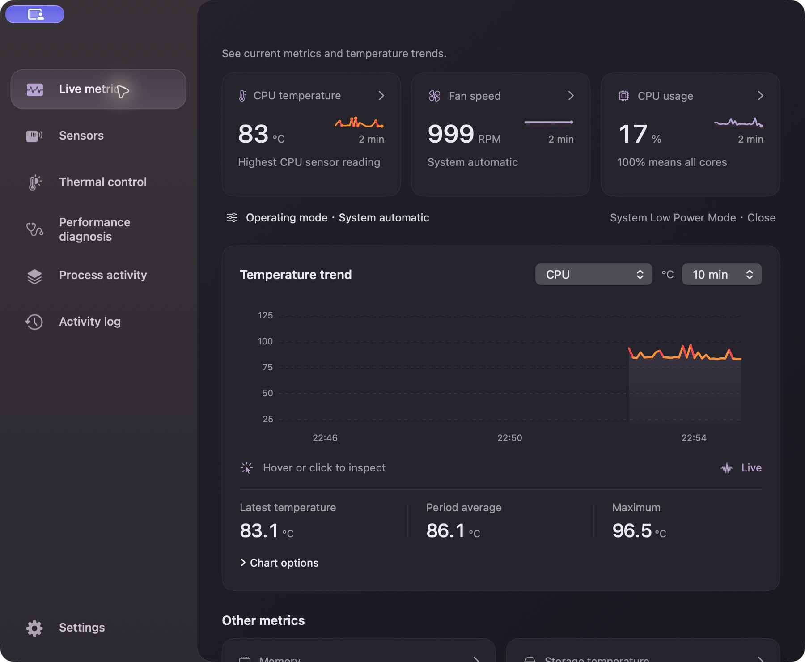
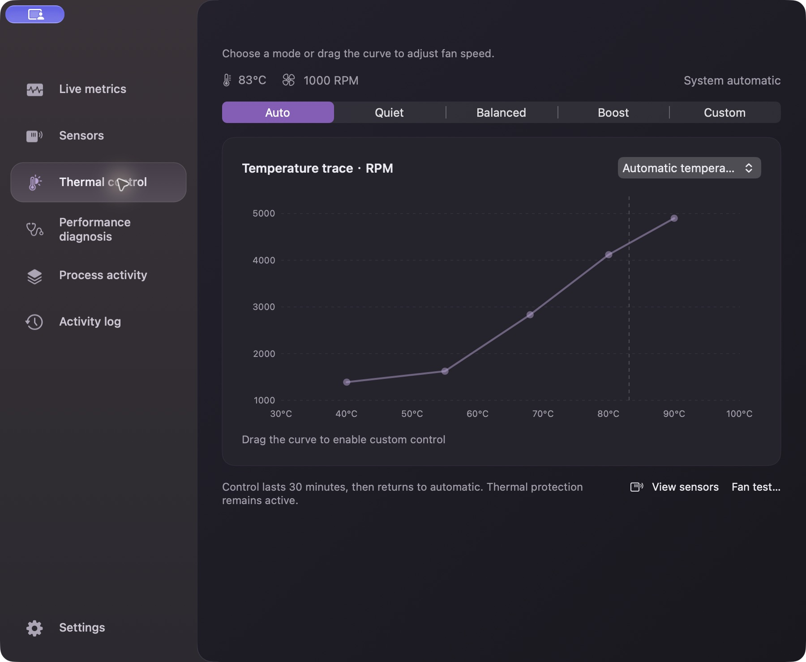
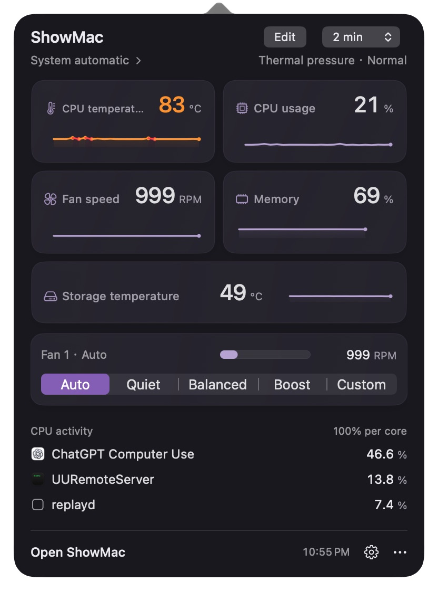
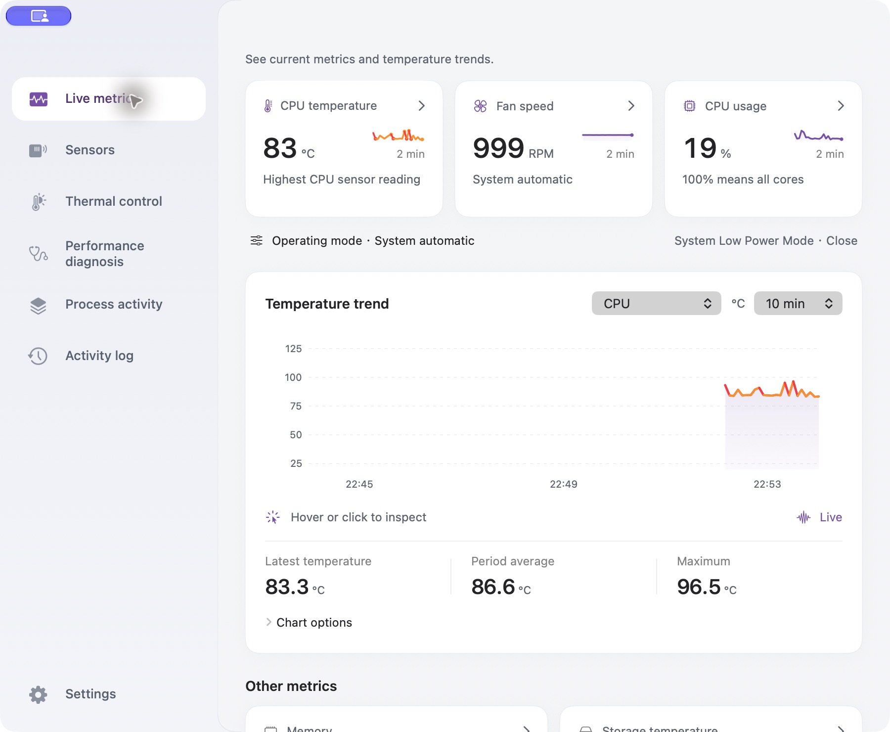
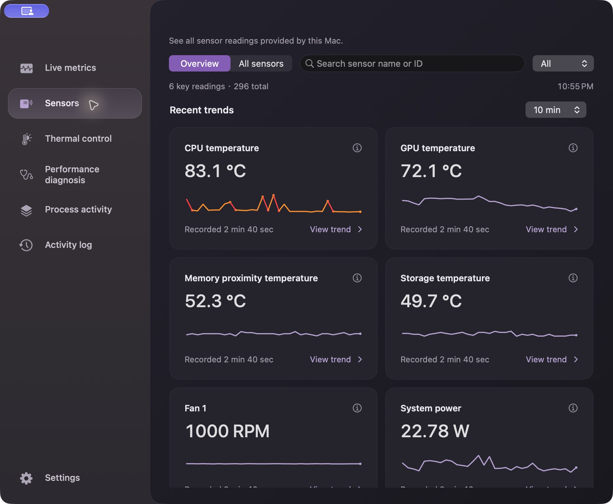

# ShowMac · ShowMac

[English](README.md) | **简体中文**


原生 macOS 温度、风扇与性能诊断工具。在菜单栏查看读数，进入主窗口观察近期趋势，或直接选择风扇档位、调整温度—转速曲线。

**当前版本：[v1.18.0 · build 266](https://101.37.211.18/showmac/#download)** · **macOS 11+** · **Intel 与 Apple Silicon**



本文截图来自最新版的英文界面；应用内可在“设置 → 界面语言”切换中文。仓库默认首页使用英文。

## 下载与启动

1. 打开 [ShowMac 官网](https://101.37.211.18/showmac/#download)，按本机芯片下载。协作者也可使用私有仓库的 [GitHub Releases](https://github.com/Jackkakaya/ThermalScope/releases)。
2. 下载适合本机芯片的 ZIP，解压后将 **ShowMac.app** 拖到“应用程序”。
3. 打开应用，点击顶部菜单栏项目。启动后先在菜单栏监测，不自动弹出主窗口。

| Mac 类型 | v1.18.0 安装包 | 控制能力 |
| --- | --- | --- |
| Intel | `ShowMac-1.18.0-macOS-x86_64.zip` | 风扇控制；睿频控制依赖本机已有且获系统批准的扩展 |
| Apple Silicon | `ShowMac-1.18.0-macOS-arm64.zip` | 按本机能力开放实验性风扇控制；睿频与电源设置控制不可用 |

预编译应用不需要 Xcode、Swift 或 Python。只读监测无需管理员授权，首次需要硬件控制时才会请求授权。当前安装包采用 ad-hoc 签名、未经公证，macOS 可能提示无法验证开发者。详见 [Intel 安装指南](docs/INSTALL.txt) 与 [Apple Silicon 安装指南](docs/INSTALL-arm64.txt)。

两个包最低均为 macOS 11。同一份应用已在 macOS 26、27 上执行检查，旧系统尚未逐版真机验证；传感器和风扇能力取决于具体机型。详见 [Apple Silicon 验证范围](docs/APPLE_SILICON_FANS.txt)。

## 日常使用

| 想做什么 | 操作入口 |
| --- | --- |
| 快速查看读数和趋势 | 左键点击菜单栏项目；点击卡片进入详情。右键点击菜单栏项目打开操作菜单。 |
| 打开完整主窗口 | 在弹窗点击“打开ShowMac”，或点击 Dock 图标。 |
| 查看历史曲线 | 在“实时监测”点击指标卡片，可选择时间范围、固定/自动刻度、线条/面积；悬停或点击温度曲线查看采样，使用“暂停图表”固定当前历史。 |
| 查找传感器 | 打开“传感器”，先看“常用读数”；也可切换“全部传感器”，按名称、编号或类型筛选。点击读数查看趋势。 |
| 排查卡顿或异常 | 在“性能诊断”查看结论与依据，在“进程活动”查看 CPU、内存与磁盘活动。 |
| 查看或导出记录 | 打开“操作记录”，查看近期操作或导出采样。 |
| 保持后台监测 | 关闭主窗口后 Dock 图标隐藏，菜单栏继续运行。使用“退出ShowMac”才能完全退出。 |

ShowMac处于当前应用时，**⌘P** 打开菜单栏面板，**⌘0** 打开主窗口，**⌘Q** 退出。

近期历史保存在内存中，最多保留本次运行的最近 30 分钟，退出后清空。缺失读数保持缺失；全机 CPU 使用率以全部核心合计 100% 计算，进程排行以单个核心 100% 计算，多线程进程可能超过 100%。

### 风扇档位与曲线

打开“温度控制”，选择 **自动、安静、均衡、强劲或自定义**。选档立即应用；拖动曲线控制点调整温度和 RPM，松手后应用，方向键可微调选中点。温度来源选项用于指定驱动曲线的读数。

随时选择“自动”即可将控制交回 macOS。接管持续 30 分钟，到期恢复自动，高温保护始终有效；页面顶部显示控制状态与剩余时间。“风扇测试…”会先确认，再进行 5 秒满速测试。



实际控制前请退出其他风扇控制软件，避免同时下发命令。Intel 睿频控制复用本机已安装、获 macOS 批准的 `com.rugarciap.DisableTurboBoost` 扩展；项目不附带或下载该驱动。

### 自由组合菜单栏

1. 打开“设置 → 状态栏”，点击“选择状态栏读数”。可选择常用指标，以及本机可读的温度、风扇、功耗、电压和电流传感器。
2. 点击或拖动“图标”“数值”“趋势”加入上方组合，拖动组件调整顺序；同一个读数可以重复添加。
3. 点击已有组件，修改样式、图标和颜色。图标可选内置符号或自选图片；默认黑白，每个组件都可独立选择预置颜色或自定义颜色。
4. 展开“字体与外观”，调整菜单栏字体、项目间距、整体外边距、组件内边距与曲线宽度。两项内外边距均支持 **0**，也可切换曲线告警色和图形底色。

### 自定义弹窗卡片

打开“设置 → 弹窗卡片 → 添加卡片”，或在菜单栏弹窗点击“编辑”。支持 1–8 张指标或传感器卡片；用上下箭头排序、移除按钮删除。风扇控制与 CPU 占用排行可分别显示或隐藏，修改自动保存。

顶部菜单栏组件与弹窗卡片分别配置。下图展示五张卡片，并开启风扇控制与进程排行。




### 主题、语言与小组件

在“设置”的“主题”中选择跟随系统、浅色或深色；“界面语言”支持英文、简繁中文、日语、韩语、德语、法语和西班牙语。应用缺省跟随系统语言，部分其他语种的文案会明确回退英文。

同页可调整“采样频率”或点击“刷新读数”。展开“系统小组件”查看相关选项；小组件支持 macOS 11+ 通知中心和 macOS 14+ 桌面。

## 更多截图

截图均来自安装版 **v1.18.0 / build 266**，拍摄于 macOS 27，使用英文界面与真实读数。传感器、数值和进程名称仅代表拍摄时的状态。来源见 [截图记录](docs/screenshots/README.txt)。

<details>
<summary>浅色主题</summary>



</details>

<details>
<summary>可读传感器名称与近期趋势</summary>



</details>

<details>
<summary>CPU 历史与图表操作</summary>


</details>

## 源码构建与检查

源码构建需要 Git、Python 3，以及包含 macOS 26.5 SDK 的完整 **Xcode 26.5/26.6**。Xcode 27 会将最低部署版本抬高到 macOS 12，不用于此 macOS 11 发布构建。项目没有第三方 Swift 包依赖。请按本机 Xcode 的安装位置修改下方 `DEVELOPER_DIR`。

```sh
export DEVELOPER_DIR=/Applications/Xcode_26.6.app/Contents/Developer
git clone https://github.com/Jackkakaya/ThermalScope.git
cd ThermalScope
make build
open build/ShowMac.app
```

`make build` 会打包主应用、授权辅助程序和 WidgetKit 扩展，并校验签名。可用 `make build APP="$PWD/build/ShowMac.app"` 指定输出位置。

```sh
make check
make perf-smoke
```

检查覆盖领域策略、发布验证、性能工具、本地化、菜单/卡片渲染和兼容布局。模拟压测使用独立进程，不写风扇、睿频或电源设置。standard/soak 配置、预算与验证边界见 [压测指南](docs/performance/SUITE.txt)。

推送 `main`、提交 PR 或手动运行工作流会生成 Intel/ARM64 构建附件。推送匹配版本标签后，CI 在双架构包和跨系统外观检查通过后发布附件。打包命令、校验值、签名状态及流程见 [CI 与发布](docs/CI-RELEASE.md)。

## 项目文档

- [English documentation](README.md)
- [开发与 Git 约定](docs/DEVELOPMENT.txt)
- [硬件验证范围](docs/APPLE_SILICON_FANS.txt)
- [产品要求](docs/PRODUCT_REQUIREMENTS.txt)
- [性能场景](docs/performance/SCENARIOS.txt) · [验证历史](docs/validation/HISTORY.txt)
- [发布记录](docs/releases/) · [历史计划](docs/plans/)
- [1.16 历史使用说明](docs/archive/README-1.16.md)
